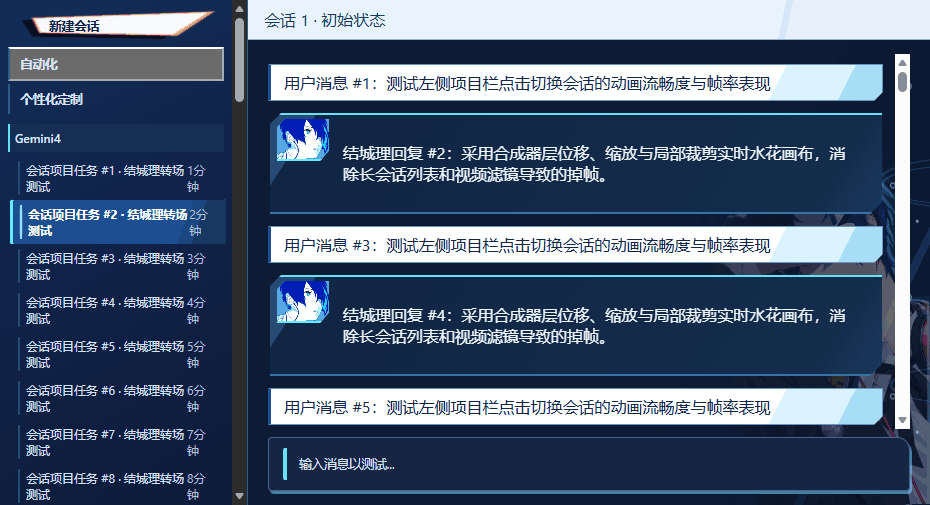
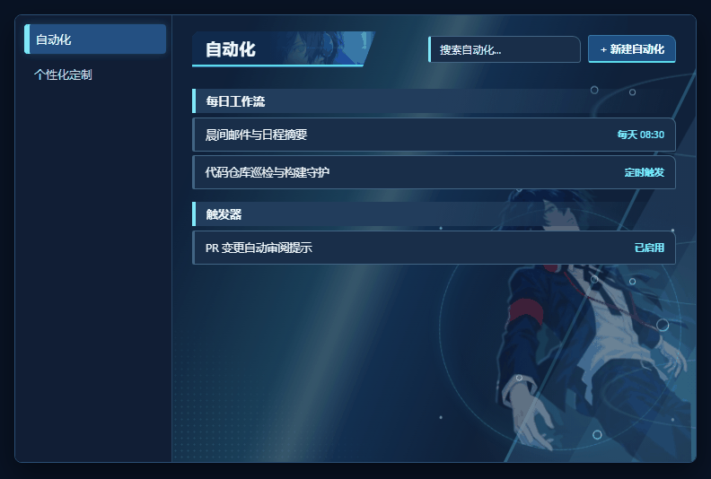

# Antigravity · 结城理独立动效版 (Persona 3 Reload Motion Theme)

面向 Windows 版 **Antigravity**（基于 `2.34.0` 验证）的《女神异闻录 3 Reload》结城理（Makoto Yuki）视觉与动效主题包。支持在**官方英文原版**上直接安装，也支持与个人自动汉化脚本 **`AntigravityChineseAuto`** 共存使用。



---

## 主题亮点

- **动态结城理立绘与 5 种眨眼对话头像**
  - **首页与聊天背景**：接入《结城理-储君》模组的 6 秒抬手取景动态立绘，人物会自然眨眼、发梢与手臂随呼吸轻摆、镜片扫过青光，并搭配「0 結城 理 / 愚者」双层浮动名牌与振翅蓝蝶。首页立绘完整展现，进入聊天页后自动转为半透明背景，不干扰阅读。
  - **气泡头像不单调**：AI 回复气泡左上角提供 **5 种结城理眨眼头像**（经典侧望、拨发正视、塔罗执牌、取景框眼、水下仰望）。连续对话时自动轮换且相邻两条不重复；最新一条回复的头像会自然眨眼并带青色呼吸流光，鼠标悬停到历史回复上也会触发眨眼。
- **P3R 水花转场与高刷流畅体验**
  - **实时水花特效**：在首页、不同对话、自动化、个性化定制及设置分类之间切换时，会触发斜切青光扫掠与实时绘制的 P3R 水波飞沫特效，自适应 60 / 120 / 144 / 165 Hz 显示器刷新率。
  - **长对话不卡顿**：针对长篇对话与左侧项目列表做了专门的性能优化，切换会话或加载历史记录时顺滑不掉帧。
- **全界面 P3R 风格统一（支持日光 / 暗夜双模式）**
  - **左右分栏与内置浏览器**：左侧导航栏采用 P3R 夜蓝斜光与青色边线，「开启新会话」「设置」等按钮悬停时切换为模组同款青色命令牌；右侧打开内置浏览器或辅助分栏时，标签栏与地址栏自动匹配主题配色，同时保持内置网页画面透明无遮挡。
  - **自动化、个性化定制与设置页**：自动化页配有水下漂浮立绘与同心水波环，个性化定制页配有塔罗牌立绘与几何光框，精选推荐卡片的「`+ 添加` / `详情`」与插件卡片按钮统一采用 P3R 钴蓝斜光与电光青底边战术按钮，在日光与暗色模式下比例协调且清晰醒目；打开设置弹窗时，顶部会有倒挂的 `SYSTEM` 结城理立绘随分类切换产生入水回弹与水花。
- **安全安装与一键还原**
  - 安装前自动按当前客户端路径、版本号和文件校验值建立独立备份；即使跨盘安装或中途遇到磁盘空间不足，也会自动回滚保护原文件，不会损坏客户端。
  - 随时可双击卸载脚本一键恢复安装前的界面。



---

## 安装与卸载（Windows）

### 1. 环境要求
- **Windows 版 Antigravity**（已在 `2.34.0` 验证）
- **Node.js 18 或更高版本**（若电脑尚未安装 Node.js，可在终端运行 `winget install OpenJS.NodeJS.LTS` 安装）

### 2. 一键安装
1. 下载解压本主题包，或使用 Git 克隆仓库：
   ```powershell
   git clone https://github.com/970316ml-cloud/antigravity-makoto-motion.git
   ```
2. 双击运行 **`安装结城理动效版.cmd`**：
   - 脚本会自动检测你的 Antigravity 安装位置、备份原始文件并写入主题；若客户端正在运行，会自动平滑重启使其生效。
   - **自定义目录或多开用户**：如果你的 Antigravity 装在非默认位置，或电脑里装了多套客户端，请用 PowerShell 指定目录安装：
     ```powershell
     powershell -ExecutionPolicy Bypass -File .\Install-Theme.ps1 -InstallDir "你的Antigravity安装目录"
     ```

### 3. 一键卸载 / 恢复原样
- **官方原版 / 社区汉化版用户**：双击 **`卸载并恢复原版界面.cmd`**（自定义目录请运行 `.\Install-Theme.ps1 -Restore -InstallDir "你的目录"`），即可把客户端精确还原到安装主题前的状态。
- **个人自动汉化脚本（`AntigravityChineseAuto`）用户**：双击 **`恢复纯汉化界面.cmd`**，即可退回纯中文界面并关闭主题动效。

---

## 兼容情况说明

| 你的客户端类型 | 支持状态 | 使用注意事项 |
| --- | --- | --- |
| **Windows 官方英文原版（`2.34.0`）** | 已完整验证 | 直接双击 `安装结城理动效版.cmd` 即可；卸载双击 `卸载并恢复原版界面.cmd` 恢复原版。 |
| **个人自动汉化脚本 `AntigravityChineseAuto`（`2.34.0`）** | 已完整验证 | 仅当客户端装在默认路径 `%LOCALAPPDATA%\Programs\antigravity` 且配有该维护脚本时自动启用共存模式；卸载双击 `恢复纯汉化界面.cmd` 恢复纯中文界面。 |
| **第三方社区汉化补丁（直接修改 `app.asar` 的方案）** | 离线仿真验证 | 请在**干净的汉化状态**下安装本主题，卸载时会还原回该汉化版本。**注意**：以后升级第三方汉化补丁前，请先双击 `卸载并恢复原版界面.cmd` 卸载本主题，升级完汉化后再重新安装主题，不要在已装主题的状态下直接拿第三方补丁硬覆盖（安装器检测到文件被外部混改会拒绝执行，以防改坏客户端）。 |

---

## 随附小工具说明（`WindowTransitions.exe`）

为了消除 Windows 窗口最小化/还原时的系统残影，主题内置了一个可选的 23 行 C# 辅助小工具（源码位于 [theme/WindowTransitions.cs](./theme/WindowTransitions.cs)，仅调用 Windows 原生 DWM 接口关闭窗口过渡动画，无任何联网或第三方依赖）：

- **重编译脚本**：双击或在 PowerShell 运行 [build-helper.ps1](./build-helper.ps1) 即可用 Windows 自带的 C# 编译器从源码重新生成。
- **编译命令**：
  ```powershell
  C:\Windows\Microsoft.NET\Framework64\v4.0.30319\csc.exe /nologo /target:winexe /optimize+ /out:theme\WindowTransitions.exe theme\WindowTransitions.cs
  ```
- **当前版本文件校验（SHA-256，记录于 [theme/WindowTransitions.sha256](./theme/WindowTransitions.sha256)）**：
  `9ed843c4940528844de2a8d81f43bb49fc733f9d60dc8d5fce13447731f893f5`
- **可随时删掉**：客户端启动前会核对该文件的 SHA-256；如果你不需要它或直接删掉 `WindowTransitions.exe`，主题只会跳过“关闭系统窗口缩放动画”这一步，**所有界面主题与结城理动效均照常工作**。

---

## 文件夹里有什么

```text
antigravity-makoto-motion/
├── 安装结城理动效版.cmd           # 双击一键安装主题
├── 卸载并恢复原版界面.cmd         # 双击卸载主题、还原安装前状态（原版/社区汉化适用）
├── 恢复纯汉化界面.cmd             # 双击恢复纯中文界面（AntigravityChineseAuto 适用）
├── 使用说明.txt                   # 简明文本版使用说明
├── Install-Theme.ps1              # 安装、备份、回滚与卸载主脚本
├── prepare.cjs                    # 主题打包、备份校验与文件完整性检查脚本
├── build-helper.ps1               # 从源码重新编译 WindowTransitions.exe 的脚本
├── window-hook.cjs                # 自动汉化模式下的窗口事件挂载辅助
├── update-extension.txt           # 自动汉化模式下的更新衔接模板
└── theme/
    ├── makoto.css                 # 主界面、侧边栏、聊天气泡与设置面板配色样式
    ├── motion.css                 # 立绘呼吸、蓝蝶振翅、水波浮动与 5 种头像眨眼动画
    ├── pages.css                  # 自动化、个性化定制、右键菜单与右侧分栏样式
    ├── renderer.js                # 页面切换转场、Canvas 实时水花与头像轮换逻辑
    ├── asar.cjs                   # 零依赖 ASAR 归档读写工具
    ├── patch.cjs                  # 主题注入脚本
    ├── window-events.cjs          # 窗口还原防白屏与辅助工具校验脚本
    ├── WindowTransitions.cs       # 窗口过渡动画关闭工具 C# 源码
    ├── WindowTransitions.exe      # 上述源码编译出的可选辅助程序
    ├── WindowTransitions.sha256   # 辅助程序的 SHA-256 校验值
    └── art/                       # 结城理动态立绘视频、5 种眨眼头像与 UI 贴图素材
```

---

## 代码与美术素材声明

- **代码部分**：本仓库中的安装与卸载脚本（`*.ps1`、`*.cmd`）、构建脚本（`*.cjs`）、前端动效与样式代码（`renderer.js`、`*.css`）以及 `WindowTransitions.cs` 均为本项目编写的实现代码。
- **美术素材（`theme/art/`）**：`theme/art/` 中的角色立绘、Spine 动作视频（`portrait-idle.webm`）、5 种眨眼头像、名牌/阿卡纳/蓝蝶/命令牌等贴图提取自《女神异闻录 3 Reload》社区模组 `P3Makoto`（结城理-储君）及原作相关美术资源。**列出素材来源仅作致谢，不代表拥有这些第三方美术资源的公开再分发授权**；本仓库素材仅供个人非商业学习与本地主题体验，若需公开二次分发打包文件，请先取得原作者/权利人授权或替换为自制素材。
